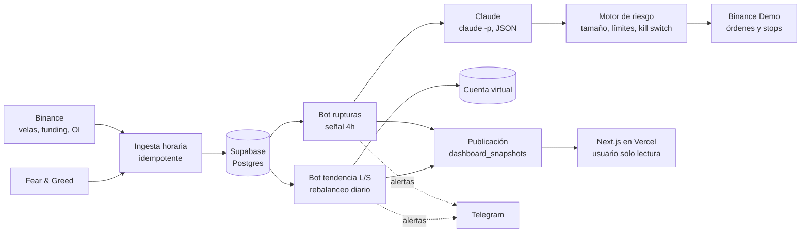

# a2tradingbot

Bots de trading de cripto que operan **solo en papel**, con Claude como analista de IA, y un proceso de investigación que mide con honestidad si alguna estrategia le gana a comprar y mantener BTC después de comisiones.

**Dashboard en vivo:** https://web-pi-inky-0cgra45qzm.vercel.app

> Proyecto experimental y educativo. Opera con dinero de prueba (Binance Demo Trading y una cuenta virtual). No es consejo de inversión.

## Qué hay aquí

- **Dos bots operando 24/7 en papel:**
  - *Rupturas* (`donchian-4h-20`) en la cuenta demo de Binance, con órdenes reales, stops en el exchange y trailing stop.
  - *Tendencia largo/corto* con tamaño por volatilidad, en una cuenta virtual con precios reales, comisiones y funding.
- **Claude como analista de IA:** revisa cada señal antes de operar y devuelve una decisión en JSON validado. Solo puede reducir o vetar; el riesgo y la ejecución son código.
- **Un pipeline de datos idempotente:** más de 175.000 velas de 1h desde 2019, funding, open interest y Fear & Greed, en Postgres (Supabase).
- **Backtesting sin trampas:** simulación vela a vela con costos reales, holdout out-of-sample y walk-forward de 6 años.
- **Evaluación estadística de la IA:** experimentos pre-registrados, bootstrap por bloques y métricas que no premian el azar.
- **Dashboard web** en Next.js estilo terminal de trading, desplegado en Vercel con un usuario de base de datos de solo lectura.
- **Alertas por Telegram** de operaciones, rebalanceos y cualquier error.

## Arquitectura



Todo corre en un solo proceso con APScheduler: ingesta y ciclo de rupturas a los 2 minutos de cada hora, tendencia a las 00:15 UTC. Si el proceso se cae, un lanzador lo reinicia al minuto. Si el PC estuvo apagado, el bot de tendencia procesa los días que faltaron, en orden.

## Resultados

Todo el detalle está en el [registro de investigación](docs/investigacion.md). Cada idea se anota antes de probarla, con su criterio de éxito y el número de intentos acumulados (hoy: 9 variantes de estrategia y 2 prompts de IA).

### Estrategias (walk-forward 2022–2026, sin apalancamiento)

| Estrategia | Retorno anual | Caída máx. | Sharpe |
|---|---|---|---|
| **Tendencia largo/corto** (tamaño por volatilidad) | +17,4% | −33,6% | **0,71** |
| Tendencia solo largo | +13,6% | **−18,5%** | **0,78** |
| Rupturas (la mejor de 7 variantes, elegida cada año) | +0,5% | −14,0% | 0,11 |
| BTC comprar y mantener | +10,4% | −66,9% | 0,45 |

- Las **rupturas** tienen una ventaja chica: ganaron en 2022–2025, pero pasan casi todo el tiempo fuera del mercado y no compensan frente a BTC. Out-of-sample (2025–26): −9,8%.
- La **tendencia** cumplió el criterio fijado antes de correrla y resistió las pruebas de solidez: sin SOL, ejecutando un día tarde y con el triple de costos. La diferencia de Sharpe con BTC todavía cabe en el ruido estadístico; la prueba que falta es el paper trading que ya está corriendo.

### ¿Claude mejora las señales?

| Experimento | Muestra | Resultado |
|---|---|---|
| v1: Sonnet aprueba, reduce o veta | 300 señales históricas | habilidad +0,043 R (IC 90%: −0,009 a +0,094) |
| v2: Opus, más contexto, puntaje de 0 a 100 | 300 señales nuevas | correlación −0,04 (IC 90%: −0,14 a +0,06) |

Ninguno de los dos supera al azar con evidencia estadística. El v2 no cumplió su criterio pre-registrado, así que el bot sigue con el v1, que es más barato.

### Lo que se aprendió en el camino

- **Un bug en la métrica cambia las conclusiones.** El R múltiplo se dividía por la distancia al stop ya movido por el trailing. El backtest daba +35% pero −0,26 R por operación; la contradicción llevó al bug, y corregirlo cambió el veredicto sobre la IA.
- **Las muestras chicas engañan.** Con 36 revisiones, la IA parecía "peor que el azar con evidencia estadística"; con 300, era indistinguible.
- **Optimizar en el pasado no elige bien el futuro.** Elegir cada año la variante con mejor Sharpe previo rindió menos que quedarse con una fija.
- **La infraestructura también falla:** caché que muestra datos viejos, un proceso con configuración desactualizada, un `fetch` que no existe para futuros. Cada uno quedó corregido, con un test.

## Stack

| Área | Herramientas |
|---|---|
| Datos y backend | Python 3.12, pandas, NumPy, ccxt, psycopg 3, pydantic, APScheduler |
| Base de datos | Supabase (Postgres): upserts idempotentes, roles de solo lectura, advisory locks |
| IA | Claude Code en modo no interactivo (`claude -p`), salida JSON validada con pydantic, prompts versionados |
| Evaluación | Backtest vela a vela, walk-forward, bootstrap por bloques, Spearman, pre-registro |
| Frontend | Next.js 16 (Cache Components), React, Tailwind CSS v4, Recharts, TypeScript |
| Operación | Vercel, Telegram Bot API, Programador de tareas de Windows, Docker |
| Calidad | pytest (100 tests), ESLint, TypeScript estricto |

## Puesta en marcha

Requisitos: Python 3.12+, [Claude Code](https://docs.claude.com/en/docs/claude-code) con sesión iniciada, un proyecto de Supabase y una cuenta en [Binance Demo Trading](https://demo.binance.com).

```bash
python -m venv .venv
source .venv/bin/activate          # Windows: .venv\Scripts\activate
pip install -e ".[dev]"
cp .env.example .env               # llaves de la cuenta demo (sin permiso de retiro) y DATABASE_URL
```

1. En el SQL Editor de Supabase, ejecuta en orden los archivos de `sql/` (001 a 006).
2. Revisa `config/settings.toml`: exchange, monedas, riesgo, IA y estrategia de tendencia.
3. Chequea las conexiones con `python -m tradebot.check`. Debe salir `OK` en claude, exchange y supabase.

## Comandos

| Qué | Comando |
|---|---|
| Bajar datos (retoma desde lo último) | `python -m tradebot.ingest` |
| Bajar historia desde una fecha | `python -m tradebot.ingest --since 2019-09-01` |
| Correr los bots (cada hora y cada día) | `python -m tradebot.run` |
| Un solo ciclo | `python -m tradebot.run --once` |
| Reanudar tras el kill switch | `python -m tradebot.run --reanudar` |
| Backtest in-sample / out-of-sample | `python -m tradebot.backtest` / `--period oos` |
| Walk-forward de las rupturas | `python -m tradebot.backtest.walkforward` |
| Backtest de la tendencia | `python -m tradebot.backtest.trend` |
| Evaluar la IA (por tandas) | `python -m tradebot.ai_eval --prompt v2 --modelo opus --n 30` |
| Informe de la evaluación | `python -m tradebot.ai_eval --prompt v2 --reporte` |
| Publicar los datos del dashboard | `python -m tradebot.publish --todo` |
| Tests | `pytest` |

En Windows, `scripts/registrar_tarea.ps1` registra el bot en el Programador de tareas para que arranque al iniciar sesión. Para un servidor con Docker, ver [docs/despliegue.md](docs/despliegue.md).

## Dashboard

El bot publica los datos ya calculados en la tabla `dashboard_snapshots` después de cada ciclo. El dashboard (`web/`) solo puede leer esa tabla, con un usuario de base de datos de solo lectura, así que corre en Vercel sin acceso al PC ni a las llaves del exchange.

Para desplegarlo:

1. Crea el usuario de solo lectura con `python -m tradebot.publish --crear-lector`.
2. En Vercel, importa el repo con **Root Directory** `web`.
3. Agrega la variable `DASHBOARD_DATABASE_URL`.

## Estructura

```
config/settings.toml          parámetros de los bots, IA, riesgo y backtest
sql/                          esquema de Supabase (001-006)
src/tradebot/
  data/, ingest.py            descarga paginada e idempotente de velas y contexto
  features/, strategy.py      indicadores sin look-ahead y señales
  backtest/                   motor, variantes, walk-forward, tendencia, resultado por señal
  ai/                         contrato del analista, Claude CLI, contexto y prompts v1/v2
  ai_eval.py                  evaluación estadística de la IA
  risk.py, broker/            riesgo y ejecución en Binance (ccxt)
  live/                       ciclo de rupturas y cuenta virtual de tendencia
  reporting.py, publish.py    datos del dashboard
  run.py                      scheduler de ambos bots
web/                          dashboard en Next.js
docs/investigacion.md         registro de investigación
tests/                        100 tests
```

## Seguridad

- Solo llaves de cuentas demo, sin permiso de retiro. Viven en `.env`, que nunca se sube al repo.
- La llave Ed25519 de Binance se lee desde un archivo fuera del repo.
- El dashboard usa un rol de Postgres que solo puede leer una tabla.
