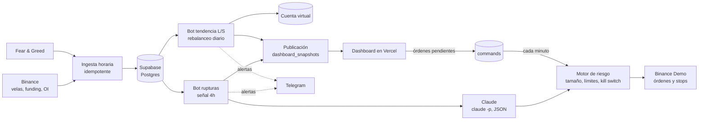

# a2tradingbot

Bots de trading de cripto que operan **solo en papel**, con Claude como analista de IA, un dashboard en vivo con panel de control y un proceso de investigación que mide con honestidad si alguna estrategia le gana a comprar y mantener BTC después de comisiones.

**Dashboard en vivo:** https://web-pi-inky-0cgra45qzm.vercel.app

> Proyecto experimental y educativo. Opera con dinero de prueba (Binance Demo Trading y una cuenta virtual). No es consejo de inversión.

**Contenido:** [Qué hace](#qué-hace) · [Arquitectura](#arquitectura) · [Resultados](#resultados) · [Instalación](#instalación-paso-a-paso) · [Dashboard](#dashboard) · [Operación diaria](#operación-diaria) · [Estructura](#estructura) · [Seguridad](#seguridad) · [Hoja de ruta](#hoja-de-ruta)

## Qué hace

- **Dos bots operando 24/7 en papel** sobre BTC, ETH y SOL (perpetuos USDT):
  - *Rupturas* (`donchian-4h-20`): entra cuando una vela de 4h cierra fuera del canal de las 20 anteriores. Opera en Binance Demo con órdenes reales, stop en el exchange y trailing stop. Arriesga 0,3% del capital por operación.
  - *Tendencia largo/corto*: siempre invertido según la tendencia a 20, 60 y 120 días, con tamaño por volatilidad y sin apalancamiento. Rebalancea a diario en una cuenta virtual con precios reales, comisiones y funding.
- **Claude como analista de IA:** revisa cada señal de rupturas y devuelve una decisión en JSON validado. Solo puede reducir el tamaño o vetar; el riesgo y la ejecución son código.
- **Motor de riesgo:** tamaño por riesgo fijo, tope de nocional 1x, máximo 3 posiciones, pérdida diaria máxima de 2% y kill switch si la cuenta cae 10% desde su máximo.
- **Pipeline de datos idempotente:** más de 175.000 velas de 1h desde 2019, funding, open interest y Fear & Greed, en Postgres (Supabase).
- **Backtesting sin trampas:** simulación vela a vela con costos reales, holdout out-of-sample, walk-forward de 6 años y experimentos pre-registrados.
- **Dashboard web** estilo terminal de trading (Next.js en Vercel):
  - precios y velas en vivo con EMA 50/200, canal de 20 velas y RSI, con las mismas fórmulas que el bot;
  - posiciones con su gráfico, ganadas y perdidas, métricas contra BTC;
  - **ruta proyectada vs real:** la banda que esperaba el backtest contra la curva de capital real;
  - **panel de control** con contraseña: agresividad de cada bot y operaciones manuales con lectura del mercado.
- **Alertas por Telegram** de aperturas, cierres, rebalanceos, cambios desde el panel, resumen mensual y cualquier error.

## Arquitectura



Todo corre en un solo proceso con APScheduler:

| Cuándo (UTC) | Qué |
|---|---|
| Minuto 2 de cada hora | Ingesta de datos y ciclo de rupturas (decide solo al cerrar una vela de 4h) |
| Cada minuto | Órdenes del panel de control (si hay) |
| 00:15 | Rebalanceo de la tendencia |
| Día 1, 00:40 | Resumen mensual de la tendencia por Telegram |

El dashboard **nunca toca el exchange ni las llaves**: lee datos ya publicados con un usuario de solo lectura, y los controles solo dejan órdenes pendientes que el bot valida con sus propias reglas.

## Resultados

Todo el detalle está en el [registro de investigación](docs/investigacion.md). Cada idea se anota antes de probarla, con su criterio de éxito y el número de intentos acumulados (hoy: 9 variantes de estrategia y 2 prompts de IA).

### Estrategias (walk-forward 2022–2026, sin apalancamiento)

| Estrategia | Retorno anual | Caída máx. | Sharpe |
|---|---|---|---|
| **Tendencia largo/corto** (tamaño por volatilidad) | +17,4% | −33,6% | **0,71** |
| Tendencia solo largo | +13,6% | **−18,5%** | **0,78** |
| Rupturas (la mejor de 7 variantes, elegida cada año) | +0,5% | −14,0% | 0,11 |
| BTC comprar y mantener | +10,4% | −66,9% | 0,45 |

- Las **rupturas** tienen una ventaja chica: ganaron en 2022–2025, pero pasan casi todo el tiempo fuera del mercado y no compensan frente a BTC. Out-of-sample (2025–26): −9,8%.
- La **tendencia** cumplió el criterio fijado antes de correrla y resistió las pruebas de solidez: sin SOL, ejecutando un día tarde y con el triple de costos. La diferencia de Sharpe con BTC todavía cabe en el ruido estadístico; la prueba que falta es el paper trading que ya está corriendo.

### ¿Claude mejora las señales?

| Experimento | Muestra | Resultado |
|---|---|---|
| v1: Sonnet aprueba, reduce o veta | 300 señales históricas | habilidad +0,043 R (IC 90%: −0,009 a +0,094) |
| v2: Opus, más contexto, puntaje de 0 a 100 | 300 señales nuevas | correlación −0,04 (IC 90%: −0,14 a +0,06) |

Ninguno de los dos supera al azar con evidencia estadística. El v2 no cumplió su criterio pre-registrado, así que el bot sigue con el v1, que es más barato.

### Lo que se aprendió en el camino

- **Un bug en la métrica cambia las conclusiones.** El R múltiplo se dividía por la distancia al stop ya movido por el trailing. El backtest daba +35% pero −0,26 R por operación; la contradicción llevó al bug, y corregirlo cambió el veredicto sobre la IA.
- **Las muestras chicas engañan.** Con 36 revisiones, la IA parecía "peor que el azar con evidencia estadística"; con 300, era indistinguible.
- **Optimizar en el pasado no elige bien el futuro.** Elegir cada año la variante con mejor Sharpe previo rindió menos que quedarse con una fija.
- **La infraestructura también falla:** caché que muestra datos viejos, un proceso con configuración desactualizada, un `fetch` que no existe para futuros. Cada uno quedó corregido, con un test.

## Instalación paso a paso

### Lo que necesitas

| Qué | Para qué | Dónde |
|---|---|---|
| Python 3.12+ | El bot | python.org |
| Node.js 20+ | El dashboard (opcional) | nodejs.org |
| [Claude Code](https://docs.claude.com/en/docs/claude-code) con sesión iniciada | El analista de IA (`claude -p`) | `npm install -g @anthropic-ai/claude-code` y luego `claude` |
| Proyecto de Supabase (gratis) | La base de datos | supabase.com |
| Cuenta de Binance Demo Trading | Las órdenes en papel | demo.binance.com |
| Bot de Telegram (opcional) | Las alertas | @BotFather |

### 1. Clonar e instalar

```bash
git clone https://github.com/Ang3lRamos/a2tradingbot.git
cd a2tradingbot
python -m venv .venv
source .venv/bin/activate          # Windows: .venv\Scripts\activate
pip install -e ".[dev]"
cp .env.example .env               # Windows: copy .env.example .env
```

### 2. Llaves de Binance Demo

1. Entra a [demo.binance.com](https://demo.binance.com) → **API Management** → crea una llave.
   - *System generated* (HMAC): copia la API key y el secret a `BINANCE_API_KEY` y `BINANCE_API_SECRET`.
   - *Ed25519* (más segura): guarda la llave privada **fuera del repo y fuera de carpetas sincronizadas** y pon su ruta en `BINANCE_PRIVATE_KEY_PATH`.
2. Habilita futuros y **no** le des permiso de retiro.
3. En futuros, deja el modo de posición en **One-way** (una posición por moneda): el broker lo supone.

### 3. Base de datos (Supabase)

1. Crea un proyecto en Supabase.
2. **Connect → Session pooler → URI**: cópiala a `DATABASE_URL` en `.env`, con tu contraseña.
3. Crea el esquema (se puede repetir sin riesgo, por ejemplo después de un `git pull`):

```bash
python -m tradebot.setup_db
```

### 4. Revisar la configuración

`config/settings.toml` tiene las monedas, el riesgo, la IA y las estrategias. Los valores del repo son los que se probaron en la investigación; si cambias alguno, el resultado deja de ser comparable con el backtest.

### 5. Comprobar las conexiones

```bash
python -m tradebot.check
```

Debe salir `OK` en claude, exchange y supabase.

### 6. Bajar el historial

Las estrategias y los backtests necesitan historia. La primera vez tarda (son años de velas de 1h); después, cada ingesta retoma desde lo último.

```bash
python -m tradebot.ingest --since 2019-09-01
```

### 7. Arrancar el bot

```bash
python -m tradebot.run            # corre indefinidamente
python -m tradebot.run --once     # un solo ciclo, para probar
```

Para dejarlo 24/7:

- **Windows:** `powershell -NoProfile -ExecutionPolicy Bypass -File scripts\registrar_tarea.ps1` lo registra en el Programador de tareas (arranca al iniciar sesión y se relanza si se cae; log en `logs\bot.log`).
- **Servidor con Docker:** ver [docs/despliegue.md](docs/despliegue.md).

Corre el bot **en un solo lugar a la vez**: dos copias operarían la misma cuenta.

### 8. Alertas por Telegram (opcional)

1. En Telegram, habla con **@BotFather**, envía `/newbot` y copia el token a `TELEGRAM_BOT_TOKEN`.
2. Mándale un mensaje a tu bot y abre `https://api.telegram.org/bot<TOKEN>/getUpdates`: copia el `chat.id` a `TELEGRAM_CHAT_ID`.

## Dashboard

El bot publica los datos ya calculados en la tabla `dashboard_snapshots` después de cada ciclo. El dashboard (`web/`) los lee con un usuario de base de datos que solo puede leer esa tabla.

### En tu PC

```bash
python -m tradebot.publish --crear-lector     # crea el usuario de solo lectura y escribe su URL en web/.env.local
python -m tradebot.publish --todo             # publica todos los datos por primera vez
cd web
npm install
npm run dev                                   # http://localhost:3000
```

En Windows también sirve doble clic en `ver_dashboard.cmd`.

### En Vercel

1. En Vercel, **Add New → Project** e importa el repo.
2. **Root Directory:** `web`.
3. **Settings → Environment Variables:** agrega `DASHBOARD_DATABASE_URL` con el valor de `web/.env.local`.
4. Despliega. Cada `git push` a `main` vuelve a desplegar solo.

### Panel de control (opcional)

Detrás de una contraseña, el dashboard permite:

- **Agresividad de cada bot**, de ×0,25 a ×2 (×1 es lo que se probó en el backtest). En rupturas multiplica el riesgo por operación; en tendencia, la exposición, que nunca pasa de 100%.
- **Operaciones manuales** en Binance Demo: moneda, dirección, riesgo y stop, con una lectura del mercado (tendencia, RSI, canal, volatilidad y cuántas lecturas apoyan la dirección). Salen con stop en el exchange y el mismo trailing que el bot, se marcan como `manual` y **no entran en las métricas de la estrategia**.

Cómo funciona: el dashboard deja una orden pendiente en la tabla `commands`; el bot la revisa cada minuto, la valida con sus reglas de riesgo y la ejecuta. Si espera más de 10 minutos (bot apagado), se rechaza para no ejecutarla tarde a otro precio.

Para activarlo:

1. `python -m tradebot.publish --crear-operador` crea el usuario `dashboard_operator` (solo puede crear órdenes pendientes y leer su estado) y escribe su URL en `.env` y `web/.env.local`.
2. En `web/.env.local` y en Vercel agrega las variables de [`web/.env.example`](web/.env.example): `DASHBOARD_OPERATOR_URL`, `CONTROL_PASSWORD` y `CONTROL_SESSION_SECRET` (32+ caracteres al azar).
3. En Vercel, **Deployments → ⋯ → Redeploy** para que tome las variables.

Sin esas variables, el panel queda apagado y el dashboard es solo de lectura.

## Operación diaria

| Qué | Comando |
|---|---|
| Ver lo que hace el bot | `logs/bot.log` (Windows) o `docker compose logs -f bot` |
| Un ciclo manual | `python -m tradebot.run --once` |
| Reanudar tras el kill switch (después de revisar) | `python -m tradebot.run --reanudar` |
| Aplicar cambios de esquema tras un `git pull` | `python -m tradebot.setup_db` |
| Republicar todo el dashboard | `python -m tradebot.publish --todo` |
| Resumen mensual de la tendencia, sin enviarlo | `python -m tradebot.live.trend_report --mes 2026-11 --sin-enviar` |
| Bajar datos a mano | `python -m tradebot.ingest` |
| Tests | `pytest` |

**Después de actualizar el código o agregar claves nuevas a `settings.toml`, reinicia el bot.** El proceso que ya está corriendo sigue con la versión que cargó al arrancar. En Windows:

```powershell
Stop-ScheduledTask tradebot
Get-CimInstance Win32_Process -Filter "Name='python.exe'" | Where-Object { $_.CommandLine -like '*tradebot.run*' } | ForEach-Object { Stop-Process -Id $_.ProcessId -Force }
Start-ScheduledTask tradebot
```

Mejor hacerlo lejos del minuto 2 de cada hora, cuando corre el ciclo. Las posiciones abiertas no se afectan: sus stops están en el exchange y el bot las reconoce al volver.

### Investigación

| Qué | Comando |
|---|---|
| Backtest in-sample / out-of-sample | `python -m tradebot.backtest` / `--period oos` |
| Comparar las variantes | `python -m tradebot.backtest.compare` |
| Walk-forward de las rupturas | `python -m tradebot.backtest.walkforward` |
| Backtest de la tendencia | `python -m tradebot.backtest.trend` |
| Evaluar la IA (por tandas) | `python -m tradebot.ai_eval --prompt v2 --modelo opus --n 30` |
| Informe de la evaluación | `python -m tradebot.ai_eval --prompt v2 --reporte` |

Antes de probar una idea nueva, anótala en [docs/investigacion.md](docs/investigacion.md) con su criterio de éxito.

## Estructura

```
config/settings.toml          parámetros de los bots, IA, riesgo y backtest
sql/                          esquema de la base (001-007), lo aplica tradebot.setup_db
src/tradebot/
  data/, ingest.py            descarga paginada e idempotente de velas y contexto
  features/, strategy.py      indicadores sin look-ahead y señales
  backtest/                   motor, variantes, walk-forward, tendencia
  ai/, ai_eval.py             analista (Claude CLI, prompts v1/v2) y su evaluación estadística
  risk.py, broker/            riesgo y ejecución en Binance (ccxt)
  live/                       ciclo de rupturas, cuenta virtual de tendencia, órdenes del panel,
                              agresividad y resumen mensual
  projection.py               banda esperada por el backtest (ruta proyectada)
  reporting.py, publish.py    datos del dashboard
  run.py                      scheduler de todo
  setup_db.py, check.py       esquema de la base y chequeo de conexiones
web/                          dashboard en Next.js (app/, components/, lib/)
docs/                         investigación, resultados y despliegue en servidor
scripts/                      registro del bot en el Programador de tareas de Windows
tests/                        123 tests
```

## Stack

| Área | Herramientas |
|---|---|
| Datos y backend | Python 3.12, pandas, NumPy, ccxt, psycopg 3, pydantic, APScheduler |
| Base de datos | Supabase (Postgres): upserts idempotentes, roles con permisos mínimos, RLS, cola con `skip locked` |
| IA | Claude Code en modo no interactivo (`claude -p`), salida JSON validada con pydantic, prompts versionados |
| Evaluación | Backtest vela a vela, walk-forward, bootstrap por bloques, Spearman, pre-registro |
| Frontend | Next.js 16 (Cache Components, Server Actions), React 19, Tailwind CSS v4, Recharts, lightweight-charts |
| Operación | Vercel, Telegram Bot API, Programador de tareas de Windows, Docker |
| Calidad | pytest (123 tests), ESLint, TypeScript estricto |

## Seguridad

- Solo llaves de cuentas demo, sin permiso de retiro. Viven en `.env`, que nunca se sube al repo; la llave Ed25519 se lee desde un archivo fuera del repo.
- El broker se niega a operar fuera de demo o testnet.
- El dashboard usa dos usuarios de Postgres con permisos mínimos: `dashboard_reader` solo lee `dashboard_snapshots`; `dashboard_operator` solo crea órdenes pendientes en `commands` y lee su estado (no puede marcarlas como hechas ni leer posiciones).
- El panel de control exige contraseña; la sesión es una cookie httpOnly firmada que vence a las 12 horas. Cada acción vuelve a verificarla en el servidor, y el bot vuelve a validar cada orden con sus reglas de riesgo.

## Hoja de ruta

La meta próxima es **terminar 3 meses de paper trading (mediados de febrero de 2027) y decidir con datos si alguna estrategia merece dinero real.** Los criterios, las próximas mejoras y las ideas en cola están en [docs/roadmap.md](docs/roadmap.md).
